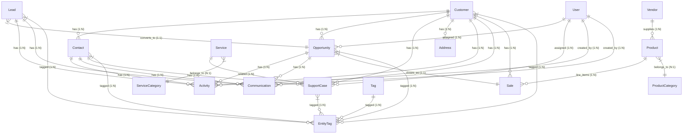

# راهنمای کاربری MudBlazor CRM

## ۱. داشبورد و شاخص‌های کلیدی (CRM Dashboard)
- **مسیر**: `/crmdashboard`
- **نمایش شاخص‌های کلیدی (KPI)**:
  - تعداد سرنخ‌های جدید ۳۰ روز اخیر
  - درآمد کل
  - نرخ تبدیل سرنخ به مشتری
  - ارزش کل پایپ‌لاین باز
  - تعداد معاملات بسته‌شده
  - میانگین ارزش معامله
  - تعداد کل مشتریان
  - تیکت‌های پشتیبانی باز
- **نمودارهای تحلیلی**:
  - فروش در طول زمان (Line Chart)
  - منابع سرنخ‌ها (Doughnut Chart)
  - ارزش پایپ‌لاین بر اساس مرحله (Bar Chart)
  - قیف پایپ‌لاین (Funnel Chart)
- **فید فعالیت اخیر** و **بهترین فرصت‌ها**
- **یادداشت‌های سریع**
- **قابلیت جابه‌جایی و بازچینی کارت‌ها** (Drag & Drop، Reset Layout)

---

## ۲. مدیریت مشتریان، مخاطبین و آدرس‌ها (Customers, Contacts & Addresses)

### مشتریان (Customers)
- **مسیر**: `/Customer`
- **فیلدها**: نام، نوع، صنعت، وب‌سایت، تعداد کارمندان، درآمد سالانه، وضعیت، مدیر حساب، لوگو، یادداشت، آدرس، مخاطبین مرتبط
- **عملیات**: افزودن، ویرایش، حذف، جستجو، صادر کردن CSV

### مخاطبین (Contacts)
- **مسیر**: `/Contact`
- **فیلدها**: نام، ایمیل، تلفن، عنوان شغلی، وضعیت، یادداشت، عکس، مشتری مرتبط
- **عملیات**: افزودن، ویرایش، حذف، جستجو، **ارسال ایمیل مستقیم** از طریق دیالوگ

### آدرس‌ها (Addresses)
- **مسیر**: `/Address`
- **فیلدها**: خیابان، شهر، استان، کد پستی، کشور
- **کاربرد**: اتصال به مشتریان، مخاطبین و تامین‌کنندگان

---

## ۳. سرنخ‌ها، فرصت‌ها و برد پایپ‌لاین (Leads, Opportunities & Pipeline)

### سرنخ‌ها (Leads)
- **مسیر**: `/Lead`
- **فیلدها**: منبع، وضعیت، ارزش بالقوه، یادداشت
- **پیگیری سرنخ‌های فروش** از منابع مختلف

### فرصت‌ها (Opportunities)
- **مسیر**: `/Opportunity`
- **فیلدها**: نام، مبلغ (`Value`)، احتمال (`Probability`)، مرحله (`Stage`)، تاریخ تخمینی/واقعی بسته شدن، مشتری، مخاطب، کاربر محول، دلیل از دست دادن، اطلاعات رقبا، آیکون، یادداشت
- **مراحل**: Prospecting → Qualification → Proposal → Negotiation → Closed Won / Closed Lost

### برد پایپ‌لاین (Pipeline Board)
- **مسیر**: `/pipeline`
- **نمایش Kanban** فرصت‌ها در مراحل مختلف
- **Drag & Drop** برای تغییر مرحله فرصت‌ها
- **نمایش جمع ارزش** هر مرحله
- **افزودن/ویرایش/حذف** مستقیم از روی بورد

---

## ۴. فعالیت‌ها، وظایف، تقویم و ارتباطات (Activities, Tasks, Calendar & Communications)

### فعالیت‌ها (Activities)
- **مسیر**: `/Activity`
- **انواع**: تماس (Call)، ایمیل (Email)، جلسه (Meeting)، یادداشت (Note)
- **فیلدها**: نوع، موضوع، توضیحات، تاریخ، مدت زمان (دقیقه)، وضعیت، جهت (داخلی/خارجی)، مشتری/مخاطب/سرنخ/فرصت مرتبط
- **عملیات**: افزودن، ویرایش، حذف، جستجو، **صادر کردن CSV**

### وظایف (Todo Tasks)
- **لیست وظایف**: `/TodoTask` — نمایش جدولی با فیلتر، جستجو، صفحه‌بندی
- **بورد کانبان**: `/KanbanTodoTask` — ۴ ستون: To Do، Open، In Process، Done
- **فیلدها**: نام، توضیحات، وضعیت، تاریخ سررسید، تاریخ پیگیری، یادداشت، آیکون
- **Drag & Drop** بین ستون‌ها برای تغییر وضعیت
- **افزودن سریع** وظیفه از داخل هر ستون

### تقویم (Calendar)
- **مسیر**: `/calendar`
- **نمای ماهانه** با نمایش رویدادها
- **فیلتر**: همه، فعالیت‌ها، وظایف
- **رنگ‌بندی** بر اساس نوع رویداد
- **کلیک روی روز** برای مشاهده جزئیات رویدادها

### ارتباطات (Communications)
- **مسیر**: `/communication`
- **انواع**: Email، Call، Meeting، Note، SMS، VideoCall، InPerson، SocialMedia
- **جهت**: Inbound، Outbound
- **فیلدها**: موضوع، متن کامل، وضعیت، نتیجه، نیاز به پیگیری، تاریخ پیگیری، مدت زمان
- **مرتبط با**: مخاطب، سرنخ، مشتری، فرصت، تیکت پشتیبانی

---

## ۵. محصولات، خدمات، فروش و تامین‌کنندگان (Products, Services, Sales & Vendors)

### محصولات (Products)
- **مسیر**: `/Product`
- **فیلدها**: نام، قیمت، توضیحات، دسته‌بندی، آیکون

### دسته‌بندی محصولات (Product Categories)
- **مسیر**: `/ProductCategory`

### خدمات (Services)
- **مسیر**: `/Service`
- **فیلدها**: نام، قیمت، توضیحات، دسته‌بندی، آیکون

### دسته‌بندی خدمات (Service Categories)
- **مسیر**: `/ServiceCategory`

### فروش (Sales)
- **مسیر**: `/Sale`
- **ثبت و پیگیری فاکتورها و فروش‌ها**
- **فیلدها**: تعداد، قیمت واحد، مبلغ کل، تاریخ فروش، یادداشت

### تامین‌کنندگان (Vendors)
- **مسیر**: `/Vendor`
- **فیلدها**: نام، نوع، صنعت، وب‌سایت، آدرس، مخاطب اصلی، لوگو، یادداشت

---

## ۶. تیکت‌های پشتیبانی، پاداش‌ها و برچسب‌ها (Support Cases, Rewards & Tags)

### تیکت‌های پشتیبانی (Support Cases)
- **مسیر**: `/SupportCase`
- **فیلدها**: عنوان، اولویت (Priority)، وضعیت (Status)، دسته‌بندی، کانال، مشتری، مخاطب، محصول/خدمات مرتبط، توضیحات، راه‌حل، کاربر محول، ساعات SLA، تاریخ سررسید، تاریخ حل، تاریخ پیگیری، تاریخ صعود، آیکون، یادداشت
- **پیگیری کامل چرخه زندگی تیکت**

### پاداش‌ها (Rewards)
- **مسیر**: `/Reward`
- **مدیریت اعتبار دلاری، امتیازهای پاداش و نرخ تبدیل** مرتبط با مخاطبین

### برچسب‌ها (Tags)
- **مسیر**: `/Tag`
- **تعریف و مدیریت برچسب‌های رنگی و نام‌گذاری‌شده** برای دسته‌بندی رکوردهای CRM
- **انتخاب برچسب** در فرم‌های مختلف موجودیت‌ها

---

## ۷. گزارش‌ها، قالب‌های ایمیل، ورود داده و مدیریت (Reports, Email Templates, Import & Admin)

### گزارش‌ها (Reports)
- **مسیر**: `/reports`
- **انواع گزارش**:
  - **فروش در طول زمان**: درآمد و تعداد فروش به تفکیک ماه
  - **پایپ‌لین بر اساس مرحله**: تعداد و ارزش کل در هر مرحله
  - **خلاصه فعالیت‌ها**: تعداد کل، تفکیک بر اساس نوع و وضعیت
- **فیلتر تاریخ** (از/تا)

### قالب‌های ایمیل (Email Templates)
- **مسیر**: `/emailtemplate`
- **ساخت و ویرایش قالب‌های آماده** با عنوان، متن ساده و HTML
- **استفاده برای ارسال سریع** به مشتریان از فرم مخاطبین

### ورود داده (Data Import)
- **مسیر**: `/import`
- **ورود گروهی از فایل CSV** برای موجودیت‌ها:
  - مخاطبین: Name, Email, Phone, Role, Notes
  - مشتریان: Name, Type, Industry, Notes
  - سرنخ‌ها: Source, Status, PotentialValue, Notes
  - فرصت‌ها: Name, Stage, Value, Probability, Source, Notes
  - فروش: Quantity, UnitPrice, TotalAmount, SaleDate, Notes
- **حداکثر اندازه فایل**: ۱۰ مگابایت

### مدیریت (Administration) — فقط نقش `Administrator`
- **کاربران**: `/user` — مدیریت کاربران و نقش‌ها
- **لاگ ممیزی**: `/auditlog` — پیگیری تمام تغییرات سیستم

---

## ۸. دستیار هوشمند، حافظه دانش و پیوست فایل (AI Assistant, Knowledge & Attachments)

### دستیار هوشمند (AI Assistant)
- **دسترسی**: دکمه شناور در پایین صفحه (آیکون هوش مصنوعی)
- **سه حالت کنترل**:
  - **دستی (Manual)**: هر اقدام نیازمند تایید کاربر
  - **نیمه‌خودکار (Semi-Auto)**: عملیات خواندنی خودکار، نوشتن/حذف نیازمند تایید
  - **خودکار (Auto)**: اجرای خودکار در محدوده مجاز
- **قابلیت‌ها**:
  - **ناوبری**: رفتن به صفحات، انتخاب تب‌ها
  - **تعامل با فرم‌ها**: پر کردن فیلدها، باز کردن ComboBox، انتخاب گزینه‌ها
  - **تعامل با جداول**: اسکن، مرتب‌سازی، فیلتر، انتخاب ردیف
  - **کلیک دکمه‌ها**: ذخیره، حذف، اقدامات سفارشی
  - **آپلود فایل** به فیلدهای فرم
  - **خواندن صفحه** (OCR/Vision) برای درک محتوای بصری
  - **جستجوی راهنما** و terminologies
  - **پرسش از کاربر** برای اطمینان از اطلاعات گمشده
  - **نمایش نمودار** و KPI در پاسخ
- **محدودیت‌های امنیتی**:
  - عملیات حذف و تایید همیشه نیازمند تایید مستقیم کاربر
  - دستیار بدون خواندن رکورد هدف یا بدون داشتن نام دقیق اجازه حذف ندارد
  - مسیرهای حساس (مدیریت کاربران، لاگ ممیزی، ورود داده، قالب ایمیل) مسدود هستند
  - کنترل بودجه: حداکثر ۲۵ مرحله، ۴۰ فراخوانی مدل، ۰.۸۰ دلار هر تسک

### حافظه دانش (Knowledge Base)
- **ابزارها**: `remember` (ذخیره واقعه)، `ask_knowledge` (پرسش)، `correct_fact` (تصحیح)، `delete_fact` (حذف)، `fact_did_not_help` (بازخورد منفی)
- **دانش تاییدشده** بدون داده کاربری یا دستورالعمل حساس ذخیره می‌شود
- **جستجوی معنایی** در دانش ذخیره‌شده

### پیوست فایل (Attachments)
- **پنل دستیار**: Drag & Drop یا دکمه گیره برای پیوست فایل
- **فرمت‌های پشتیبانی‌شده**: CSV، XLSX، متنی (txt, md, json, log, csv, tsv)، تصویر (png, jpg, jpeg, webp)
- **حداکثر اندازه**: ۱۰ مگابایت در فایل
- **حداکثر تعداد**: ۵ فایل در هر بار انتخاب
- **پردازش هوشمند**: دستیار محتوای فایل را تحلیل می‌کند و در صورت نیاز با اجازه کاربر در فرم‌های صفحه آپلود می‌کند
- **پیوست‌های موجودیت**: هر موجودیت (مشتری، فرصت، تیکت و...) قابلیت آپلود/دانلود/حذف فایل را دارد (`EntityAttachments` component)

---

## ۹. خط زمان و تاریخچه موجودیت‌ها (Entity Timeline)
- **نمایش خط زمان فعالیت** برای هر موجودیت (مشتری، فرصت، تیکت و...)
- **انواع رویداد**: تماس، ایمیل، جلسه، یادداشت، وظیفه، فروش، تیکت پشتیبانی
- **رنگ‌بندی بر اساس نوع رویداد**
- **دسترسی**: در فرم جزئیات/ویرایش هر موجودیت

---

## ۱۰. جستجوی سراسری (Global Search)
- **مکان**: نوار بالای برنامه (Header)
- **جستجو در**: مشتریان، مخاطبین، فرصت‌ها، سرنخ‌ها
- **نمایش نتایج** با نام و نوع موجودیت
- **کلیک برای هدایت مستقیم** به لیست موجودیت با فیلتر جستجو

---

## ۱۱. اعلان‌ها (Notifications)
- **آیکون زنگوله** در هدر
- **انواع**: هشدار (Alert)، هشدار (Warning)، یادآوری (Reminder)
- **نشان‌دهنده تعداد خوانده‌نشده** (Badge)
- **عملیات**: علامت‌گذاری به عنوان خوانده، مشاهده همه، بروزرسانی

---

## ۱۲. سفارشی‌سازی و تم‌ها (Theming & Customization)
- **منوی تم‌ها** در هدر (آیکون برس)
- **حالت تاریک/روشن** (Dark/Light Mode)
- **رنگ اصلی** قابل تغییر
- **ذخیره ترجیحات** در LocalStorage

---

## ۱۳. پروفایل و احراز هویت (Profile & Auth)
- **تغییر رمز عبور**: `/account/changePassword`
- **خروج از سیستم** (Logout)
- **ثبت‌نام/ورود** برای کاربران جدید

---

## ۱۴. صدور داده‌ها (Data Export)
- **صادر کردن CSV** در اکثر صفحات لیست (فعالیت‌ها، و...) از طریق دکمه Export
- **شامل تمام فیلدهای قابل مشاهده** در گرید

---

## ۱۵. مرجع فنی برای دستیار هوشمند (Agent Technical Reference)

این بخش تنها برای **دستیار هوشمند** طراحی شده و شامل داده‌های دقیق فیلدها، Enumها، قوانین کسب‌وکار و الگوهای پرامپت است.

### ۱۵.۱ Field IDs دقیق فرم‌ها (برای `set_field` / `pick_option`)

#### Customer Form (`/Customer` - Add/Update)
| Field ID | Label | Type | Required | Notes |
|----------|-------|------|----------|-------|
| `name` | نام مشتری | Text | ✓ | Max 200 chars |
| `type` | نوع | Select | | Options: `Customer`, `Partner`, `Competitor`, `Lead` |
| `industry` | صنعت | Text | | Max 100 chars |
| `website` | وب‌سایت | Text | | URL format |
| `employeeCount` | تعداد کارمندان | Number | | Integer ≥ 0 |
| `annualRevenue` | درآمد سالانه | Number | | Decimal ≥ 0 |
| `status` | وضعیت | Select | | Options: `Active`, `Inactive`, `Prospect` |
| `accountManagerId` | مدیر حساب | User Lookup | | Select from users |
| `addressId` | آدرس | Address Lookup | | Select existing or create new |
| `logo` | لوگو | File Upload | | Image file |
| `notes` | یادداشت | TextArea | | Max 2000 chars |

#### Contact Form (`/Contact` - Add/Update)
| Field ID | Label | Type | Required | Notes |
|----------|-------|------|----------|-------|
| `name` | نام | Text | ✓ | Max 200 chars |
| `email` | ایمیل | Email | ✓ | Unique per customer |
| `phone` | تلفن | Text | | Max 50 chars |
| `role` | عنوان شغلی | Text | | Max 100 chars |
| `status` | وضعیت | Select | | Options: `Active`, `Inactive` |
| `customerId` | مشتری | Customer Lookup | ✓ | Required |
| `photo` | عکس | File Upload | | Image file |
| `notes` | یادداشت | TextArea | | Max 1000 chars |

#### Opportunity Form (`/Opportunity` - Add/Update)
| Field ID | Label | Type | Required | Notes |
|----------|-------|------|----------|-------|
| `name` | نام فرصت | Text | ✓ | Max 200 chars |
| `value` | مبلغ | Number | ✓ | Decimal ≥ 0 |
| `probability` | احتمال | Number | | Integer 0-100 |
| `stage` | مرحله | Select | ✓ | See Enum values below |
| `estimatedCloseDate` | تاریخ تخمینی بسته شدن | Date | | |
| `actualCloseDate` | تاریخ واقعی بسته شدن | Date | | Auto-set on Close Won/Lost |
| `customerId` | مشتری | Customer Lookup | ✓ | |
| `contactId` | مخاطب | Contact Lookup | | |
| `assignedUserId` | کاربر محول | User Lookup | | |
| `lostReason` | دلیل از دست دادن | TextArea | | Required if Stage = Closed Lost |
| `competitorInfo` | اطلاعات رقبا | TextArea | | |
| `icon` | آیکون | Text | | Material icon name |
| `notes` | یادداشت | TextArea | | Max 2000 chars |

#### Lead Form (`/Lead` - Add/Update)
| Field ID | Label | Type | Required | Notes |
|----------|-------|------|----------|-------|
| `source` | منبع | Text | ✓ | Max 100 chars |
| `status` | وضعیت | Select | ✓ | Options: `New`, `Contacted`, `Qualified`, `Lost`, `Converted` |
| `potentialValue` | ارزش بالقوه | Number | | Decimal ≥ 0 |
| `notes` | یادداشت | TextArea | | |

#### SupportCase Form (`/SupportCase` - Add/Update)
| Field ID | Label | Type | Required | Notes |
|----------|-------|------|----------|-------|
| `title` | عنوان | Text | ✓ | Max 200 chars |
| `customerId` | مشتری | Customer Lookup | ✓ | |
| `contactId` | مخاطب | Contact Lookup | | |
| `productId` | محصول | Product Lookup | | |
| `serviceId` | خدمات | Service Lookup | | |
| `priority` | اولویت | Select | ✓ | See Enum values below |
| `status` | وضعیت | Select | ✓ | See Enum values below |
| `category` | دسته‌بندی | Text | | Max 100 chars |
| `channel` | کانال | Select | | Options: `Email`, `Phone`, `Portal`, `Chat`, `In Person` |
| `description` | توضیحات | TextArea | ✓ | Max 4000 chars |
| `resolution` | راه‌حل | TextArea | | Max 4000 chars |
| `assignedUserId` | کاربر محول | User Lookup | | |
| `slaHours` | ساعات SLA | Number | | Integer 0-720 |
| `dueDate` | تاریخ سررسید | DateTime | | |
| `followupDate` | تاریخ پیگیری | DateTime | | |
| `icon` | آیکون | Text | | Material icon name |
| `notes` | یادداشت | TextArea | | Max 2000 chars |

#### Activity Form (`/Activity` - Add/Update)
| Field ID | Label | Type | Required | Notes |
|----------|-------|------|----------|-------|
| `type` | نوع | Select | ✓ | Options: `Call`, `Email`, `Meeting`, `Note` |
| `subject` | موضوع | Text | ✓ | Max 200 chars |
| `description` | توضیحات | TextArea | | |
| `activityDate` | تاریخ فعالیت | DateTime | ✓ | |
| `durationMinutes` | مدت زمان (دقیقه) | Number | | Integer ≥ 0 |
| `status` | وضعیت | Select | | Options: `Planned`, `Completed`, `Cancelled` |
| `direction` | جهت | Select | | Options: `Inbound`, `Outbound` |
| `customerId` | مشتری | Customer Lookup | * | One of Customer/Contact/Lead/Opportunity required |
| `contactId` | مخاطب | Contact Lookup | * | |
| `leadId` | سرنخ | Lead Lookup | * | |
| `opportunityId` | فرصت | Opportunity Lookup | * | |

#### Communication Form (`/communication` - Add/Update)
| Field ID | Label | Type | Required | Notes |
|----------|-------|------|----------|-------|
| `type` | نوع | Select | ✓ | See CommunicationTypes below |
| `direction` | جهت | Select | ✓ | `Inbound`, `Outbound` |
| `subject` | موضوع | Text | | Max 500 chars |
| `body` | متن کامل | TextArea | | |
| `status` | وضعیت | Select | | Options: `Completed`, `Pending`, `Scheduled`, `Cancelled` |
| `contactId` | مخاطب | Contact Lookup | * | One reference required |
| `leadId` | سرنخ | Lead Lookup | * | |
| `customerId` | مشتری | Customer Lookup | * | |
| `opportunityId` | فرصت | Opportunity Lookup | * | |
| `supportCaseId` | تیکت پشتیبانی | SupportCase Lookup | * | |
| `communicationDate` | تاریخ ارتباط | DateTime | ✓ | |
| `durationMinutes` | مدت زمان | Number | | 0-1440 |
| `outcome` | نتیجه | Text | | Max 500 chars |
| `followUpRequired` | نیاز به پیگیری | Checkbox | | |
| `followUpDate` | تاریخ پیگیری | DateTime | | Required if followUpRequired |
| `notes` | یادداشت | TextArea | | Max 2000 chars |

#### TodoTask Form (`/TodoTask` / `/KanbanTodoTask` - Add/Update)
| Field ID | Label | Type | Required | Notes |
|----------|-------|------|----------|-------|
| `name` | نام وظیفه | Text | ✓ | Max 200 chars |
| `description` | توضیحات | TextArea | | |
| `status` | وضعیت | Select | ✓ | Kanban column: `To Do`, `Open`, `In Process`, `Done` |
| `dueDate` | تاریخ سررسید | Date | | |
| `followupDate` | تاریخ پیگیری | Date | | |
| `notes` | یادداشت | TextArea | | |
| `icon` | آیکون | Text | | Material icon name |

#### Product Form (`/Product` - Add/Update)
| Field ID | Label | Type | Required | Notes |
|----------|-------|------|----------|-------|
| `name` | نام | Text | ✓ | |
| `price` | قیمت | Number | ✓ | Decimal ≥ 0 |
| `description` | توضیحات | TextArea | | |
| `categoryId` | دسته‌بندی | Select | | ProductCategory Lookup |
| `icon` | آیکون | Text | | Material icon name |

#### Sale Form (`/Sale` - Add/Update)
| Field ID | Label | Type | Required | Notes |
|----------|-------|------|----------|-------|
| `quantity` | تعداد | Number | ✓ | Integer > 0 |
| `unitPrice` | قیمت واحد | Number | ✓ | Decimal ≥ 0 |
| `totalAmount` | مبلغ کل | Number | ✓ | Auto-calc: quantity × unitPrice |
| `saleDate` | تاریخ فروش | Date | ✓ | |
| `notes` | یادداشت | TextArea | | |

---

### ۱۵.۲ Enum Values (مقادیر مجاز Dropdownها)

#### Opportunity.Stage
```
Prospecting
Qualification
Proposal
Negotiation
Closed Won
Closed Lost
```

#### Lead.Status
```
New
Contacted
Qualified
Lost
Converted
```

#### SupportCase.Priority
```
Low
Medium
High
Critical
```

#### SupportCase.Status
```
New
In Progress
On Hold
Resolved
Closed
```

#### SupportCase.Channel
```
Email
Phone
Portal
Chat
In Person
```

#### Activity.Type
```
Call
Email
Meeting
Note
```

#### Activity.Status
```
Planned
Completed
Cancelled
```

#### Activity.Direction
```
Inbound
Outbound
```

#### Communication.Type (CommunicationTypes)
```
Email
Call
Meeting
Note
SMS
VideoCall
InPerson
SocialMedia
```

#### Communication.Direction
```
Inbound
Outbound
```

#### Communication.Status
```
Completed
Pending
Scheduled
Cancelled
```

#### TodoTask.Status (Kanban Columns)
```
To Do
Open
In Process
Done
```

#### Customer.Type
```
Customer
Partner
Competitor
Lead
```

#### Customer.Status
```
Active
Inactive
Prospect
```

#### Contact.Status
```
Active
Inactive
```

#### Vendor.Type
```
Supplier
Partner
Contractor
Service Provider
```

---

### ۱۵.۳ قوانین کسب‌وکار و وابستگی‌ها (Business Rules & Dependencies)

| قانون | توضیح | پیام خطای احتمالی |
|--------|-------|------------------|
| **Lead → Opportunity** | سرنخ باید ابتدا `Qualified` شود، سپس Convert به Opportunity | "Lead must be qualified before conversion" |
| **Opportunity → Sale** | فقط فرصت‌های `Closed Won` می‌توانند Sale بسازند | "Opportunity must be Closed Won to create sale" |
| **Contact.CustomerId** | هر مخاطب **باید** به یک مشتری متصل باشد | "Customer is required for contact" |
| **SupportCase Reference** | تیکت باید حداقل یکی از Customer/Contact/Product/Service داشته باشد | "At least one reference (Customer, Contact, Product, Service) is required" |
| **Activity Reference** | فعالیت باید دقیقاً به یکی از Customer/Contact/Lead/Opportunity متصل باشد | "Activity must be linked to exactly one entity" |
| **Communication Reference** | ارتباط باید به حداقل یک موجودیت (Customer/Contact/Lead/Opportunity/SupportCase) متصل باشد | "Communication must have at least one reference" |
| **Opportunity.ClosedLost** | اگر Stage = `Closed Lost` → `lostReason` الزامی است | "Lost reason is required when stage is Closed Lost" |
| **Communication.FollowUp** | اگر `followUpRequired` = true → `followUpDate` الزامی | "Follow-up date is required when follow-up is needed" |
| **SupportCase.SLA** | اگر Priority = `Critical` → SLA پیش‌فرض ۴ ساعت | Auto-calculated on create |
| **TodoTask.Kanban** | تغییر ستون در کانبان = تغییر Status | Drag&Drop updates status automatically |
| **User Roles** | فقط `Administrator` به `/user` و `/auditlog` دسترسی دارد | "Access denied: Administrator role required" |
| **Soft Delete** | تمام موجودیت‌های اصلی Soft Delete دارند (IsDeleted flag) | Records hidden but not removed from DB |

---

### ۱۵.۴ الگوهای پرامپت (Few-Shot Examples برای دستیار)

#### Example 1: Create Opportunity
```
User: "یک فرصت ۵۰ میلیون تومانی برای شرکت پارسیان در مرحله Proposal بساز"
Agent Actions:
1. go_to_page("Opportunity")
2. click_action("Add") → opens AddOpportunity dialog
3. set_field(id="name", value="فرصت شرکت پارسیان")
4. set_field(id="value", value="50000000")
5. set_field(id="stage", value="Proposal")
6. set_field(id="customerId", value="پارسیان") → lookup_customer("پارسیان")
7. set_field(id="probability", value="50")
8. click_action(id="save")
```

#### Example 2: Create Support Case
```
User: "تیکت پشتیبانی اولویت بالا برای مشتری آفا با عنوان 'خطای ورود' باز کن"
Agent Actions:
1. go_to_page("SupportCase")
2. click_action("Add")
3. set_field(id="title", value="خطای ورود")
4. set_field(id="priority", value="High")
6. set_field(id="customerId", value="آفا") → lookup_customer("آفا")
7. set_field(id="description", value="کاربر نمی‌تواند با گوگل لاگین کند")
8. set_field(id="status", value="New")
9. click_action(id="save")
```

#### Example 3: Generate Sales Report
```
User: "گزارش فروش ۶ ماه اخیر رو نشون بده"
Agent Actions:
1. go_to_page("reports")
2. pick_option(id="reportType", option="sales")
3. set_field(id="fromDate", value="2026-05-01")
4. set_field(id="toDate", value="2026-11-01")
5. click_action(id="generateReport")
```

#### Example 4: Convert Lead to Opportunity
```
User: "سرنخ 'تماس از وب‌سایت' رو به فرصت تبدیل کن"
Agent Actions:
1. go_to_page("Lead")
2. search("تماس از وب‌سایت")
3. select_grid_row(rowId="lead-123")
4. click_action(id="convert") → opens conversion dialog
5. set_field(id="opportunityName", value="فرصت از سرنخ وب‌سایت")
6. set_field(id="stage", value="Qualification")
7. click_action(id="confirmConvert")
```

#### Example 5: Add Activity to Opportunity
```
User: "برای فرصت 'قرارداد دیتا' یک جلسه فردا ساعت ۱۰ ثبت کن"
Agent Actions:
1. go_to_page("Opportunity")
4. search("قرارداد دیتا")
5. select_grid_row(...)
6. click_action(id="addActivity") → opens AddActivity dialog
7. set_field(id="type", value="Meeting")
8. set_field(id="subject", value="مذاکره قرارداد")
9. set_field(id="activityDate", value="2026-11-28T10:00:00")
10. set_field(id="durationMinutes", value="60")
11. set_field(id="opportunityId", value="auto-filled from context")
12. click_action(id="save")
```

#### Example 6: Kanban Task Management
```
User: "یک وظیفه جدید 'بررسی قرارداد' در ستون In Process اضافه کن"
Agent Actions:
1. go_to_page("KanbanTodoTask")
2. click_action(id="addTask-In Process") → opens inline form in column
3. set_field(id="name", value="بررسی قرارداد")
4. set_field(id="status", value="In Process")
5. set_field(id="dueDate", value="2026-12-01")
6. click_action(id="saveTask")
```

---

### ۱۵.۵ خطاهای رایج و راه‌حل (Common Errors & Fixes)

| خطا | علت | راه‌حل دستیار |
|------|------|---------------|
| `"Required field 'Customer' is empty"` | CustomerId پر نشده در Contact/Opportunity/SupportCase | `lookup_customer` یا `go_to_page("Customer")` → create → back |
| `"Cannot delete: record has related opportunities"` | حذف Customer/Contact که فرصت دارد | ابتدا فرصت‌ها را `Closed Lost` یا حذف کنید |
| `"Attachment too large"` | فایل > ۱۰MB | "فایل باید کمتر از ۱۰ مگابایت باشد. فایل را فشرده کنید." |
| `"Permission denied: Administrator role required"` | دسترسی به `/user` یا `/auditlog` | "این عملیات نیاز به نقش Administrator دارد." |
| `"Lost reason is required"` | Stage = Closed Lost بدون lostReason | set_field(lostReason="...") قبل از Save |
| `"Follow-up date is required"` | followUpRequired=true بدون followUpDate | set_field(followUpDate="...") |
| `"Lead must be qualified before conversion"` | Lead.Status ≠ Qualified | ابتدا set_field(status="Qualified") |
| `"Opportunity must be Closed Won to create sale"` | Stage ≠ Closed Won | ابتدا فرصت را Close Won کنید |
| `"Activity must be linked to exactly one entity"` | هیچ Customer/Contact/Lead/Opportunity انتخاب نشده | یکی از lookupها را پر کنید |
| `"Email format invalid"` | فرمت ایمیل نادرست | "فرمت ایمیل معتبر وارد کنید (مثال: user@domain.com)" |

---

### ۱۵.۶ Entity Relationship Diagram (Mermaid)



---

### ۱۵.۷ کلیدهای میانبر (Keyboard Shortcuts)

| Shortcut | Action |
|----------|--------|
| `Ctrl+K` | جستجوی سراسری (Global Search) |
| `Alt+N` | رکورد جدید (در صفحات لیست) |
| `Escape` | بستن دیالوگ / پنل دستیار / منو |
| `Enter` (در چت دستیار) | ارسال پیام |
| `Shift+Enter` (در چت دستیار) | خط جدید |
| `Tab` / `Shift+Tab` | ناوبری بین فیلدها |
| `Ctrl+S` (در دیالوگ فرم) | ذخیره (اگر پشتیبانی شود) |

---

*آخرین بروزرسانی: نوامبر ۲۰۲۶ — MudBlazor CRM App*
