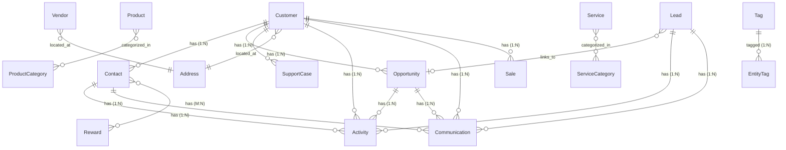

# راهنمای کاربری MudBlazor CRM

## ۱. داشبورد و شاخص‌های کلیدی (CRM Dashboard)
- **مسیر**: `/crmdashboard`
- **نمایش شاخص‌های کلیدی (KPI)**:
  - تعداد سرنخ‌های جدید ۳۰ روز اخیر
  - درآمد کل
  - نرخ تبدیل سرنخ به مشتری
  - ارزش کل پایپ‌لاین باز
  - تعداد معاملات بسته‌شده
  - میانگین ارزش معامله
  - تعداد کل مشتریان
  - تیکت‌های پشتیبانی باز
- **نمودارهای تحلیلی**:
  - فروش در طول زمان (Line Chart)
  - منابع سرنخ‌ها (Doughnut Chart)
  - ارزش پایپ‌لاین بر اساس مرحله (Bar Chart)
  - قیف پایپ‌لاین (Funnel Chart)
- **فید فعالیت اخیر** و **بهترین فرصت‌ها**
- **یادداشت‌های سریع**
- **قابلیت جابه‌جایی و بازچینی کارت‌ها** (Drag & Drop، Reset Layout)

---

## ۲. مدیریت مشتریان، مخاطبین و آدرس‌ها (Customers, Contacts & Addresses)

### مشتریان (Customers)
- **مسیر**: `/Customer`
- **فیلدها**: نام، نوع، صنعت، وب‌سایت، تعداد کارمندان، درآمد سالانه، وضعیت، مدیر حساب، لوگو، یادداشت، آدرس، مخاطبین مرتبط
- **عملیات**: افزودن، ویرایش، حذف، جستجو، صادر کردن CSV

### مخاطبین (Contacts)
- **مسیر**: `/Contact`
- **فیلدها**: نام، ایمیل، تلفن، عنوان شغلی، وضعیت، یادداشت، عکس، مشتری مرتبط
- **عملیات**: افزودن، ویرایش، حذف، جستجو، **ارسال ایمیل مستقیم** از طریق دیالوگ

### آدرس‌ها (Addresses)
- **مسیر**: `/Address`
- **فیلدها**: خیابان، شهر، استان، کد پستی، کشور
- **کاربرد**: اتصال به مشتریان، مخاطبین و تامین‌کنندگان

---

## ۳. سرنخ‌ها، فرصت‌ها و برد پایپ‌لاین (Leads, Opportunities & Pipeline)

### سرنخ‌ها (Leads)
- **مسیر**: `/Lead`
- **فیلدها**: منبع، وضعیت، ارزش بالقوه، یادداشت
- **پیگیری سرنخ‌های فروش** از منابع مختلف

### فرصت‌ها (Opportunities)
- **مسیر**: `/Opportunity`
- **فیلدها**: نام، مبلغ (`Value`)، احتمال (`Probability`)، مرحله (`Stage`)، تاریخ تخمینی/واقعی بسته شدن، مشتری، مخاطب، کاربر محول، دلیل از دست دادن، اطلاعات رقبا، آیکون، یادداشت
- **مراحل**: Prospecting → Qualification → Proposal → Negotiation → Closed Won / Closed Lost

### برد پایپ‌لاین (Pipeline Board)
- **مسیر**: `/pipeline`
- **نمایش Kanban** فرصت‌ها در مراحل مختلف
- **Drag & Drop** برای تغییر مرحله فرصت‌ها
- **نمایش جمع ارزش** هر مرحله
- **افزودن/ویرایش/حذف** مستقیم از روی بورد

---

## ۴. فعالیت‌ها، وظایف، تقویم و ارتباطات (Activities, Tasks, Calendar & Communications)

### فعالیت‌ها (Activities)
- **مسیر**: `/Activity`
- **انواع**: تماس (Call)، ایمیل (Email)، جلسه (Meeting)، یادداشت (Note)
- **فیلدها**: نوع، موضوع، توضیحات، تاریخ، مدت زمان (دقیقه)، وضعیت، جهت (داخلی/خارجی)، مشتری/مخاطب/سرنخ/فرصت مرتبط
- **عملیات**: افزودن، ویرایش، حذف، جستجو، **صادر کردن CSV**

### وظایف (Todo Tasks)
- **لیست وظایف**: `/TodoTask` — نمایش جدولی با فیلتر، جستجو، صفحه‌بندی
- **بورد کانبان**: `/KanbanTodoTask` — ۴ ستون: To Do، Open، In Process، Done
- **فیلدها**: نام، توضیحات، وضعیت، تاریخ سررسید، تاریخ پیگیری، یادداشت، آیکون
- **Drag & Drop** بین ستون‌ها برای تغییر وضعیت
- **افزودن سریع** وظیفه از داخل هر ستون

### تقویم (Calendar)
- **مسیر**: `/calendar`
- **نمای ماهانه** با نمایش رویدادها
- **فیلتر**: همه، فعالیت‌ها، وظایف
- **رنگ‌بندی** بر اساس نوع رویداد
- **کلیک روی روز** برای مشاهده جزئیات رویدادها

### ارتباطات (Communications)
- **مسیر**: `/communication`
- **انواع**: Email، Call، Meeting، Note، SMS، VideoCall، InPerson، SocialMedia
- **جهت**: Inbound، Outbound
- **فیلدها**: موضوع، متن کامل، وضعیت، نتیجه، نیاز به پیگیری، تاریخ پیگیری، مدت زمان
- **مرتبط با**: مخاطب، سرنخ، مشتری، فرصت، تیکت پشتیبانی

---

## ۵. محصولات، خدمات، فروش و تامین‌کنندگان (Products, Services, Sales & Vendors)

### محصولات (Products)
- **مسیر**: `/Product`
- **فیلدها**: نام، قیمت، توضیحات، دسته‌بندی، آیکون

### دسته‌بندی محصولات (Product Categories)
- **مسیر**: `/ProductCategory`

### خدمات (Services)
- **مسیر**: `/Service`
- **فیلدها**: نام، قیمت، توضیحات، دسته‌بندی، آیکون

### دسته‌بندی خدمات (Service Categories)
- **مسیر**: `/ServiceCategory`

### فروش (Sales)
- **مسیر**: `/Sale`
- **ثبت و پیگیری فاکتورها و فروش‌ها**
- **فیلدها**: تعداد، قیمت واحد، مبلغ کل، تاریخ فروش، یادداشت

### تامین‌کنندگان (Vendors)
- **مسیر**: `/Vendor`
- **فیلدها**: نام، نوع، صنعت، وب‌سایت، آدرس، مخاطب اصلی، لوگو، یادداشت

---

## ۶. تیکت‌های پشتیبانی، پاداش‌ها و برچسب‌ها (Support Cases, Rewards & Tags)

### تیکت‌های پشتیبانی (Support Cases)
- **مسیر**: `/SupportCase`
- **فیلدها**: عنوان، اولویت (Priority)، وضعیت (Status)، دسته‌بندی، کانال، مشتری، مخاطب، محصول/خدمات مرتبط، توضیحات، راه‌حل، کاربر محول، ساعات SLA، تاریخ سررسید، تاریخ حل، تاریخ پیگیری، تاریخ صعود، آیکون، یادداشت
- **پیگیری کامل چرخه زندگی تیکت**

### پاداش‌ها (Rewards)
- **مسیر**: `/Reward`
- **مدیریت اعتبار دلاری، امتیازهای پاداش و نرخ تبدیل** مرتبط با مخاطبین

### برچسب‌ها (Tags)
- **مسیر**: `/Tag`
- **تعریف و مدیریت برچسب‌های رنگی و نام‌گذاری‌شده** برای دسته‌بندی رکوردهای CRM
- **انتخاب برچسب** در فرم‌های مختلف موجودیت‌ها

---

## ۷. گزارش‌ها، قالب‌های ایمیل، ورود داده و مدیریت (Reports, Email Templates, Import & Admin)

### گزارش‌ها (Reports)
- **مسیر**: `/reports`
- **انواع گزارش**:
  - **فروش در طول زمان**: درآمد و تعداد فروش به تفکیک ماه
  - **پایپ‌لین بر اساس مرحله**: تعداد و ارزش کل در هر مرحله
  - **خلاصه فعالیت‌ها**: تعداد کل، تفکیک بر اساس نوع و وضعیت
- **فیلتر تاریخ** (از/تا)

### قالب‌های ایمیل (Email Templates)
- **مسیر**: `/emailtemplate`
- **ساخت و ویرایش قالب‌های آماده** با عنوان، متن ساده و HTML
- **استفاده برای ارسال سریع** به مشتریان از فرم مخاطبین

### ورود داده (Data Import)
- **مسیر**: `/import`
- **ورود گروهی از فایل CSV** برای موجودیت‌ها:
  - مخاطبین: Name, Email, Phone, Role, Notes
  - مشتریان: Name, Type, Industry, Notes
  - سرنخ‌ها: Source, Status, PotentialValue, Notes
  - فرصت‌ها: Name, Stage, Value, Probability, Source, Notes
  - فروش: Quantity, UnitPrice, TotalAmount, SaleDate, Notes
- **حداکثر اندازه فایل**: ۱۰ مگابایت

### مدیریت (Administration) — فقط نقش `Administrator`
- **کاربران**: `/user` — مدیریت کاربران و نقش‌ها
- **لاگ ممیزی**: `/auditlog` — پیگیری تمام تغییرات سیستم

---

## ۸. دستیار هوشمند، حافظه دانش و پیوست فایل (AI Assistant, Knowledge & Attachments)

### دستیار هوشمند (AI Assistant)
- **دسترسی**: دکمه شناور در پایین صفحه (آیکون هوش مصنوعی)
- **سه حالت کنترل**:
  - **دستی (Manual)**: هر اقدام نیازمند تایید کاربر
  - **نیمه‌خودکار (Semi-Auto)**: عملیات خواندنی خودکار، نوشتن/حذف نیازمند تایید
  - **خودکار (Auto)**: اجرای خودکار در محدوده مجاز
- **قابلیت‌ها**:
  - **ناوبری**: رفتن به صفحات، انتخاب تب‌ها
  - **تعامل با فرم‌ها**: پر کردن فیلدها، باز کردن ComboBox، انتخاب گزینه‌ها
  - **تعامل با جداول**: اسکن، مرتب‌سازی، فیلتر، انتخاب ردیف
  - **کلیک دکمه‌ها**: ذخیره، حذف، اقدامات سفارشی
  - **آپلود فایل** به فیلدهای فرم
  - **خواندن صفحه** (OCR/Vision) برای درک محتوای بصری
  - **جستجوی راهنما** و terminologies
  - **پرسش از کاربر** برای اطمینان از اطلاعات گمشده
  - **نمایش نمودار** و KPI در پاسخ
- **محدودیت‌های امنیتی**:
  - عملیات حذف و تایید همیشه نیازمند تایید مستقیم کاربر
  - دستیار بدون خواندن رکورد هدف یا بدون داشتن نام دقیق اجازه حذف ندارد
  - مسیرهای حساس (مدیریت کاربران، لاگ ممیزی، ورود داده، قالب ایمیل) مسدود هستند
  - کنترل بودجه: حداکثر ۲۵ مرحله، ۴۰ فراخوانی مدل، ۰.۸۰ دلار هر تسک

### حافظه دانش (Knowledge Base)
- **ابزارها**: `remember` (ذخیره واقعه)، `ask_knowledge` (پرسش)، `correct_fact` (تصحیح)، `delete_fact` (حذف)، `fact_did_not_help` (بازخورد منفی)
- **دانش تاییدشده** بدون داده کاربری یا دستورالعمل حساس ذخیره می‌شود
- **جستجوی معنایی** در دانش ذخیره‌شده

### پیوست فایل (Attachments)
- **پنل دستیار**: Drag & Drop یا دکمه گیره برای پیوست فایل
- **فرمت‌های پشتیبانی‌شده**: CSV، XLSX، متنی (txt, md, json, log, csv, tsv)، تصویر (png, jpg, jpeg, webp)
- **حداکثر اندازه**: ۱۰ مگابایت در فایل
- **حداکثر تعداد**: ۵ فایل در هر بار انتخاب
- **پردازش هوشمند**: دستیار محتوای فایل را تحلیل می‌کند و در صورت نیاز با اجازه کاربر در فرم‌های صفحه آپلود می‌کند
- **پیوست‌های موجودیت**: هر موجودیت (مشتری، فرصت، تیکت و...) قابلیت آپلود/دانلود/حذف فایل را دارد (`EntityAttachments` component)

---

## ۹. خط زمان و تاریخچه موجودیت‌ها (Entity Timeline)
- **نمایش خط زمان فعالیت** برای هر موجودیت (مشتری، فرصت، تیکت و...)
- **انواع رویداد**: تماس، ایمیل، جلسه، یادداشت، وظیفه، فروش، تیکت پشتیبانی
- **رنگ‌بندی بر اساس نوع رویداد**
- **دسترسی**: در فرم جزئیات/ویرایش هر موجودیت

---

## ۱۰. جستجوی سراسری (Global Search)
- **مکان**: نوار بالای برنامه (Header)
- **جستجو در**: مشتریان، مخاطبین، فرصت‌ها، سرنخ‌ها
- **نمایش نتایج** با نام و نوع موجودیت
- **کلیک برای هدایت مستقیم** به لیست موجودیت با فیلتر جستجو

---

## ۱۱. اعلان‌ها (Notifications)
- **آیکون زنگوله** در هدر
- **انواع**: هشدار (Alert)، هشدار (Warning)، یادآوری (Reminder)
- **نشان‌دهنده تعداد خوانده‌نشده** (Badge)
- **عملیات**: علامت‌گذاری به عنوان خوانده، مشاهده همه، بروزرسانی

---

## ۱۲. سفارشی‌سازی و تم‌ها (Theming & Customization)
- **منوی تم‌ها** در هدر (آیکون برس)
- **حالت تاریک/روشن** (Dark/Light Mode)
- **رنگ اصلی** قابل تغییر
- **ذخیره ترجیحات** در LocalStorage

---

## ۱۳. پروفایل و احراز هویت (Profile & Auth)
- **تغییر رمز عبور**: `/account/changePassword`
- **خروج از سیستم** (Logout)
- **ثبت‌نام/ورود** برای کاربران جدید

---

## ۱۴. صدور داده‌ها (Data Export)
- **صادر کردن CSV** در اکثر صفحات لیست (فعالیت‌ها، و...) از طریق دکمه Export
- **شامل تمام فیلدهای قابل مشاهده** در گرید

---

## ۱۵. مرجع فنی برای دستیار هوشمند (Agent Technical Reference)

این بخش مرجع فنی ساختار واقعی فرم‌ها، گزینه‌های `Select`، قوانین پیاده‌سازی‌شده و الگوهای ابزارهای دستیار در برنامه است.

### ۱۵.۱ فیلدهای واقعی فرم‌ها (بر اساس `Add*.razor` و `Update*.razor`)

#### Customer Form (`/Customer` - Add/Update)
| Field | Label | Control Type | Notes |
|-------|-------|--------------|-------|
| `Name` | نام / Name | Text | |
| `Type` | نوع / Type | Text | مقدار متنی آزاد |
| `Industry` | صنعت / Industry | Text | |
| `Logo` | Logo | File Upload | `.png,.jpg,.jpeg` |
| `Notes` | یادداشت‌ها / Notes | Text | |
| `AddressId` | آدرس / Address | Select | لیست آدرس‌ها (City) |
| `Contact` | مخاطب / Contact | MultiSelect | انتخاب چند مخاطب (`multiSelect: true`) |

#### Contact Form (`/Contact` - Add/Update)
| Field | Label | Control Type | Notes |
|-------|-------|--------------|-------|
| `Name` | نام / Name | Text | |
| `Company` | شرکت / Company | Text | |
| `Title` | عنوان / Title | Text | |
| `Email` | ایمیل / Email | Text | |
| `Phone` | تلفن / Phone | Text | |
| `MobilePhone` | تلفن همراه / Mobile Phone | Text | |
| `Role` | نقش / Role | Text | |
| `Department` | دپارتمان / Department | Text | |
| `LinkedInUrl` | لینکدین / LinkedIn URL | Text | |
| `Status` | وضعیت / Status | Select | `Active`, `Inactive`, `Prospect` |
| `PreferredContactMethod` | روش تماس ترجیحی / Preferred Contact Method | Select | `Email`, `Phone`, `SMS`, `LinkedIn` |
| `IsPrimary` | مخاطب اصلی / Primary Contact | Checkbox | |
| `DoNotContact` | عدم تماس / Do Not Contact | Checkbox | |
| `Photo` | Photo | File Upload | `.png,.jpg,.jpeg` |
| `Notes` | یادداشت‌ها / Notes | Text | |
| `AddressId` | آدرس / Address | Select | لیست آدرس‌ها |
| `Reward` | Reward | MultiSelect | انتخاب چند پاداش |

#### Opportunity Form (`/Opportunity` - Add/Update)
| Field | Label | Control Type | Notes |
|-------|-------|--------------|-------|
| `Name` | نام / Name | Text | Required (`[Required]`) |
| `Value` | Value ($) | Numeric | |
| `Probability` | Probability (%) | Numeric | `Min=0`, `Max=100` |
| `EstimatedCloseDate` | Estimated Close Date | DateTimeLocal | فرمت ISO (`yyyy-MM-ddTHH:mm:ss`) |
| `Stage` | مرحله / Stage | Select | پیش‌فرض `Prospecting` |
| `CustomerId` | مشتری / Customer | Select | انتخاب از مشتریان |
| `ContactId` | مخاطب / Contact | Select | انتخاب از مخاطبین |
| `Icon` | Icon | File Upload | `.png,.jpg,.jpeg` |
| `Notes` | یادداشت‌ها / Notes | Text | |

#### Lead Form (`/Lead` - Add/Update)
| Field | Label | Control Type | Notes |
|-------|-------|--------------|-------|
| `Source` | منبع / Source | Text | |
| `Status` | وضعیت / Status | Text | مقدار متنی آزاد |
| `PotentialValue` | PotentialValue | Numeric | |
| `Photo` | Photo | File Upload | `.png,.jpg,.jpeg` |
| `Notes` | یادداشت‌ها / Notes | Text | |
| `AddressId` | آدرس / Address | Select | |
| `OpportunityId` | فرصت / Opportunity | Select | |
| `ContactId` | مخاطب / Contact | Select | |

#### SupportCase Form (`/SupportCase` - Add/Update)
| Field | Label | Control Type | Notes |
|-------|-------|--------------|-------|
| `Title` | عنوان / Title | Text | |
| `CustomerId` | شناسه مشتری / Customer Id | Numeric | فیلد عددی (`MudNumericField`) |
| `ContactId` | شناسه مخاطب / Contact Id | Numeric | فیلد عددی |
| `ProductId` | شناسه محصول / Product Id | Numeric | فیلد عددی |
| `ServiceId` | شناسه خدمت / Service Id | Numeric | فیلد عددی |
| `Priority` | اولویت / Priority | Select | `Low`, `Medium`, `High`, `Critical` |
| `Status` | وضعیت / Status | Select | `New`, `Open`, `In Progress`, `Waiting on Customer`, `Resolved`, `Closed` |
| `Category` | دسته‌بندی / Category | Text | |
| `Channel` | کانال / Channel | Select | `Email`, `Phone`, `Chat`, `Portal` |
| `Description` | توضیحات / Description | TextArea | |
| `AssignedUserId` | شناسه کاربر مسئول / Assigned User Id | Text | |
| `SlaHours` | ساعات SLA / SLA Hours | Numeric | |
| `DueDate` | سررسید / Due Date | DateTimeLocal | |
| `FollowupDate` | تاریخ پیگیری / Follow-up Date | DateTimeLocal | |
| `Icon` | Icon | File Upload | `.png,.jpg,.jpeg` |
| `Notes` | یادداشت‌ها / Notes | TextArea | |

#### Activity Form (`/Activity` - Add/Update)
| Field | Label | Control Type | Notes |
|-------|-------|--------------|-------|
| `Type` | نوع / Type | Select | `Call`, `Email`, `Meeting`, `Note`, `Task` |
| `Subject` | موضوع / Subject | Text | |
| `Description` | توضیحات / Description | TextArea | |
| `ActivityDate` | تاریخ / Date | DateTimeLocal | پیش‌فرض زمان فعلی |
| `DurationMinutes` | مدت (دقیقه) / Duration (minutes) | Numeric | |
| `Status` | وضعیت / Status | Select | `Completed`, `Scheduled`, `Cancelled` |
| `Direction` | جهت / Direction | Select | `Inbound`, `Outbound` |
| `CustomerId` | مشتری / Customer | Select | |
| `ContactId` | مخاطب / Contact | Select | |
| `LeadId` | سرنخ / Lead | Select | |
| `OpportunityId` | فرصت / Opportunity | Select | |

#### Communication Form (`/communication` - Add/Update)
| Field | Label | Control Type | Notes |
|-------|-------|--------------|-------|
| `Type` | نوع / Type | Select | `Email`, `Call`, `Meeting`, `Note`, `SMS`, `Video Call`, `In Person`, `Social Media` |
| `Direction` | جهت / Direction | Select | `Outbound`, `Inbound` |
| `Subject` | موضوع / Subject | Text | |
| `Body` | متن / Body | TextArea | |
| `Status` | وضعیت / Status | Select | `Completed`, `Pending`, `Scheduled`, `Cancelled` |
| `ContactId` | شناسه مخاطب / Contact Id | Numeric | فیلد عددی |
| `CustomerId` | شناسه مشتری / Customer Id | Numeric | فیلد عددی |
| `LeadId` | شناسه سرنخ / Lead Id | Numeric | فیلد عددی |
| `OpportunityId` | شناسه فرصت / Opportunity Id | Numeric | فیلد عددی |
| `SupportCaseId` | شناسه تیکت / Support Case Id | Numeric | فیلد عددی |
| `CommunicationDate` | تاریخ / Date | DateTimeLocal | |
| `DurationMinutes` | مدت (دقیقه) / Duration (minutes) | Numeric | |
| `Outcome` | نتیجه / Outcome | Text | |
| `FollowUpRequired` | نیاز به پیگیری / Follow-up Required | Checkbox | با تیک خوردن فیلد `Follow-up Date` نمایش داده می‌شود |
| `FollowUpDate` | تاریخ پیگیری / Follow-up Date | DateTimeLocal | فقط در صورت `FollowUpRequired = true` |
| `Notes` | یادداشت‌ها / Notes | TextArea | |

#### TodoTask Form (`/TodoTask` / `/KanbanTodoTask` - Add/Update)
| Field | Label | Control Type | Notes |
|-------|-------|--------------|-------|
| `Name` | نام / Name | Text | |
| `Description` | توضیحات / Description | Text | |
| `AssignedTo` | AssignedTo | Numeric | |
| `Status` | وضعیت / Status | Text | در کانبان مقادیر `To Do`, `Open`, `In Process`, `Done` |
| `DueDate` | DueDate | DateTimeLocal | |
| `UserId` | UserId | Numeric | |
| `FollowupDate` | FollowupDate | DateTimeLocal | |
| `Icon` | Icon | File Upload | `.png,.jpg,.jpeg` |
| `Notes` | یادداشت‌ها / Notes | Text | |

#### Product Form (`/Product` - Add/Update)
| Field | Label | Control Type | Notes |
|-------|-------|--------------|-------|
| `Name` | نام / Name | Text | |
| `Description` | توضیحات / Description | Text | |
| `Price` | قیمت / Price | Numeric | |
| `StockQuantity` | StockQuantity | Numeric | |
| `Photo` | Photo | File Upload | `.png,.jpg,.jpeg` |
| `Notes` | یادداشت‌ها / Notes | Text | |
| `ProductCategory` | ProductCategory | MultiSelect | انتخاب چند دسته‌بندی |

#### Sale Form (`/Sale` - Add/Update)
| Field | Label | Control Type | Notes |
|-------|-------|--------------|-------|
| `ProductId` | ProductId | Text | |
| `ServiceId` | ServiceId | Text | |
| `CustomerId` | CustomerId | Numeric | |
| `Quantity` | تعداد / Quantity | Numeric | |
| `TotalAmount` | TotalAmount | Numeric | واردکردن مستقیم مبلغ کل |
| `SaleDate` | SaleDate | DateTimeLocal | |
| `ReceiptPhoto` | ReceiptPhoto | File Upload | `.png,.jpg,.jpeg` |
| `Notes` | یادداشت‌ها / Notes | Text | |

---

### ۱۵.۲ گزینه‌های دقیق Selectها (Enum / Dropdown Values)

#### Opportunity.Stage
```
Prospecting
Qualification
Proposal
Negotiation
Closed Won
Closed Lost
```

#### Contact.Status
```
Active
Inactive
Prospect
```

#### Contact.PreferredContactMethod
```
Email
Phone
SMS
LinkedIn
```

#### SupportCase.Priority
```
Low
Medium
High
Critical
```

#### SupportCase.Status
```
New
Open
In Progress
Waiting on Customer
Resolved
Closed
```

#### SupportCase.Channel
```
Email
Phone
Chat
Portal
```

#### Activity.Type
```
Call
Email
Meeting
Note
Task
```

#### Activity.Status
```
Completed
Scheduled
Cancelled
```

#### Activity.Direction
```
Inbound
Outbound
```

#### Communication.Type
```
Email
Call
Meeting
Note
SMS
Video Call
In Person
Social Media
```

#### Communication.Direction
```
Outbound
Inbound
```

#### Communication.Status
```
Completed
Pending
Scheduled
Cancelled
```

#### TodoTask.Status (Kanban Columns)
```
To Do
Open
In Process
Done
```

#### Reports (`/reports` — Report Type)
```
Sales Report
Pipeline Report
Activity Report
```

---

### ۱۵.۳ قوانین واقعی برنامه (Verified Behavior & Constraints)

| موضوع | رفتار واقعی در کد |
|-------|--------------------|
| **TodoTask Kanban** | بورد `/KanbanTodoTask` شامل ۴ ستون `To Do`، `Open`، `In Process` و `Done` است. |
| **Communication Follow-up** | فیلد `Follow-up Date` زمانی در فرم ظاهر می‌شود که تیک `Follow-up Required` فعال شده باشد. |
| **Administrator Only** | صفحات `/user` و `/auditlog` و کنترلر `AuditLogController` فقط برای نقش `Administrator` قابل دسترسی هستند و در مسیرهای مسدود دستیار قرار دارند. |
| **Delete Behavior** | حذف در `CommunicationController` به‌صورت Soft Delete (`IsDeleted = true`) و در سایر موجودیت‌ها (`Customer`, `Lead`, `Opportunity`, `SupportCase`, `Sale`) به‌صورت حذف مستقیم انجام می‌شود؛ در دستیار، حذف همیشه با `targetName` و تایید کاربر کنترل می‌شود. |
| **Unsaved Changes Guard** | تا زمانی که فرمی تغییرات ذخیره‌نشده دارد، ابزارهای ناوبری و `finish` توسط `AgentSafetyState` مسدود می‌شوند. |

---

### ۱۵.۴ الگوهای ابزارهای دستیار (Verified Few-Shot Examples)

> نکته: شناسه‌های اسنپ‌شات (`scan_screen`) از روی برچسب یا متن کنترل ساخته می‌شوند؛ برای مثال `نام` برای فیلد، `btn_افزودن` برای دکمه، `tab_...` برای تب و `g1_...` برای ردیف جدول. در هر اسنپ‌شات یکتا هستند و اگر صفحه تغییر کند باید دوباره `scan_screen` اجرا شود.

#### Example 1: Create Opportunity
```
User: "یک فرصت ۵۰ میلیون دلاری برای شرکت پارسیان در مرحله Proposal بساز"
Agent Actions:
1. go_to_page(name="Opportunity")
2. click_action(id="<Add button id>") → opens AddOpportunity dialog
3. set_field(id="<Name field id>", value="فرصت شرکت پارسیان")
4. set_field(id="<Value ($) field id>", value="50000000")
5. open_combo(id="<Stage field id>") → pick_option(option="Proposal")
6. open_combo(id="<Customer field id>") → pick_option(option="پارسیان")
7. click_action(id="<Add/Save button id>")
```

#### Example 2: Create Support Case
```
User: "تیکت پشتیبانی اولویت بالا با عنوان 'خطای ورود' برای مشتری شماره ۳ ثبت کن"
Agent Actions:
1. go_to_page(name="SupportCase")
2. click_action(id="<Add button id>")
3. set_field(id="<Title field id>", value="خطای ورود")
4. set_field(id="<Customer Id field id>", value="3")
5. open_combo(id="<Priority field id>") → pick_option(option="High")
6. open_combo(id="<Status field id>") → pick_option(option="New")
7. set_field(id="<Description field id>", value="کاربر نمی‌تواند وارد شود")
8. click_action(id="<Add/Save button id>")
```

#### Example 3: Generate Sales Report
```
User: "گزارش فروش ماهانه رو نشون بده"
Agent Actions:
1. go_to_page(name="reports")
2. open_combo(id="<Report Type field id>") → pick_option(option="Sales Report")
3. click_action(id="<Generate Report button id>")
```

#### Example 4: Create Activity
```
User: "یک فعالیت جلسه برای فردا ساعت ۱۰ ثبت کن"
Agent Actions:
1. go_to_page(name="Activity")
2. click_action(id="<Add button id>")
3. open_combo(id="<Type field id>") → pick_option(option="Meeting")
4. set_field(id="<Subject field id>", value="مذاکره قرارداد")
5. set_field(id="<Date field id>", value="2026-11-28T10:00:00")
6. set_field(id="<Duration (minutes) field id>", value="60")
7. click_action(id="<Add/Save button id>")
```

---

### ۱۵.۵ خطاهای واقعی و راه‌حل (Common Errors & Fixes)

| خطا / وضعیت | علت | اقدام مناسب دستیار |
|-------------|-----|--------------------|
| `Required field '...' is empty` | فیلد اجباری در فرم پر نشده است | از کاربر مقدار را با `ask_user` بپرسید و با `set_field` یا `open_combo` پر کنید |
| `Maximum file size is 10 MB` | فایل پیوست بزرگ‌تر از ۱۰ مگابایت است | به کاربر اطلاع دهید فایل باید حداکثر ۱۰ مگابایت باشد |
| `Unknown or blocked page` | مسیر در فهرست صفحات مسدود است (`/user`, `/auditlog`, `/import`, `/emailtemplate`, `/account`) | انجام این ناوبری مجاز نیست؛ به کاربر اطلاع دهید |
| `Destructive action requires an explicit targetName` | درخواست حذف بدون نام دقیق رکورد بوده است | نام یا شناسه دقیق رکورد را از کاربر بخواهید |

---

### ۱۵.۶ Entity Relationship Diagram (Mermaid)



---

### ۱۵.۷ کلیدهای میانبر (Keyboard Shortcuts)

| Shortcut | Action |
|----------|--------|
| `Escape` | بستن دیالوگ / منوی باز |
| `Enter` (در چت دستیار) | ارسال پیام یا پاسخ به سوال دستیار |
| `Shift+Enter` (در چت دستیار) | خط جدید در کادر پیام |
| `Tab` / `Shift+Tab` | ناوبری بین فیلدها |

---

*آخرین بروزرسانی: نوامبر ۲۰۲۶ — MudBlazor CRM App*
